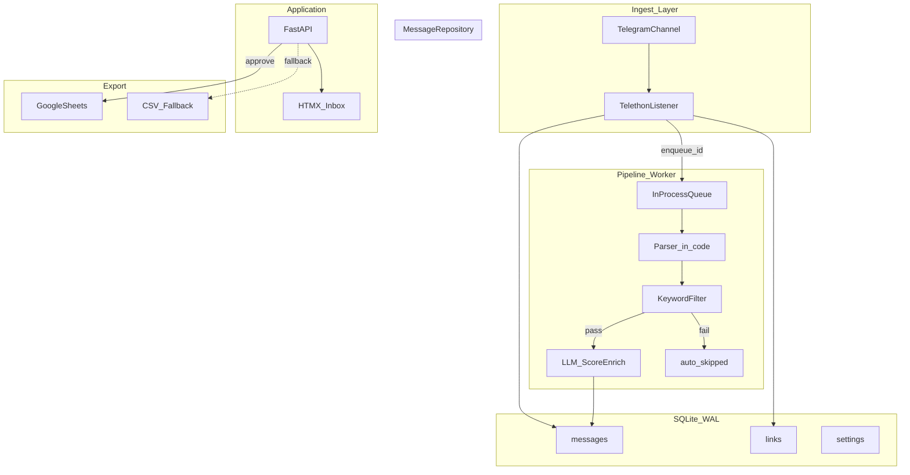

# Telegram Job Radar — Architecture Freeze v3.1

> **Status: FROZEN — v3.1 APPROVED FOR DEVELOPMENT**
>
> Ship gate: no UI until golden parser tests pass. Blocked on sample posts for fixtures.

This is the authoritative architecture document. Do not contradict without explicit user approval and a version bump.

---

## Problem

Private Telegram job channel: no copy, no messaging. User wastes time scanning posts and manually typing URLs. Solution: automated ingest, parse, score, triage in a personal inbox, export approved rows to Google Sheets.

## Constraints

- MTProto **user session** (Telethon), not bot API
- Personal single-user tool; local-first
- SQLite is source of truth; Sheets is export sink only
- Parser patterns live in **code**, not database

---

## Final architecture



### Process model

One Python process locally:

1. **Telethon listener** — inserts message + links via `MessageRepository`; enqueues `message.id` on in-process `asyncio.Queue`
2. **Pipeline worker** — consumes queue IDs; owns all `processing_state` transitions
3. **FastAPI** — serves HTMX + API; owns `review_state` and triggers `export_state` transitions only

**Queue recovery (frozen, two triggers):**

1. **Startup** — scan `pending`/`error` rows via `list_pending_for_recovery()` and enqueue
2. **Idle** — when queue becomes empty, scan again before sleeping; prevents orphaned rows after crash mid-claim

No Celery. No Redis. No Docker. In-process queue only.

### Component ownership (frozen)

| Component | May write | Must never write |
|-----------|-----------|------------------|
| **Telethon ingest** | New rows: `raw_text`, links, `processing_state=pending` | `processing_state` beyond insert, `review_state`, `export_state`, `extraction` |
| **Pipeline worker** | `processing_state`, `extraction`, `filter_passed`, `relevance_*`, `review_state` (inbox/auto_skipped), `parser_*`, `profile_version_scored`, `filter_rules_version_scored`, processing errors/retries | `review_state` approved/rejected, `export_state` |
| **FastAPI (approve/reject)** | `review_state`, `reviewed_at` | `processing_state`, `extraction` |
| **FastAPI (export)** | `export_state`, `sheet_row_id`, `exported_at`, `export_attempts`, export errors | `processing_state`, parser/LLM retry counters |
| **MessageRepository** | All persistence — sole layer executing SQL | N/A (enforces boundaries via method names) |

All DB access goes through `MessageRepository`. Raw SQL exists only in `app/db/repository.py`.

### Graceful shutdown (frozen)

On `SIGINT`/`SIGTERM`:

1. Stop accepting new Telegram events
2. Set shutdown flag on worker queue
3. Finish current message pipeline (or export) to completion
4. Commit and close SQLite connection
5. Exit

Never kill mid-transaction. Uvicorn lifespan hooks coordinate listener + worker shutdown.

### Backfill strategy (frozen)

Backfills commit in **batches of 100 messages**. Each batch: insert messages + links → commit → enqueue IDs. Interruptible; already-committed rows survive via dedup constraint.

---

## Database schema (frozen)

See [database-schema.md](./database-schema.md) for quick reference.

### Design principles

- **Merge JSON blobs** where always read/written together
- **Three orthogonal state columns** — never one `status` field
- **No `entities_json`** — URLs live in `links`
- **No normalized job-field tables**
- **Parser output is code-owned** — store result + version, not regex in DB

### Typed extraction model (frozen)

```python
class ExtractedField(BaseModel):
    value: str | None = None
    source: Literal["parser", "llm", "manual"] | None = None

class Extraction(BaseModel):
    company: ExtractedField = Field(default_factory=ExtractedField)
    role: ExtractedField = Field(default_factory=ExtractedField)
    batch: ExtractedField = Field(default_factory=ExtractedField)
    stipend: ExtractedField = Field(default_factory=ExtractedField)
    location: ExtractedField = Field(default_factory=ExtractedField)
    tags: list[str] = []
```

---

## State machines (frozen)

See [state-machines.md](./state-machines.md).

---

## LLM boundary (frozen)

### Deterministic (do not delegate to LLM)

| Task | Owner |
|------|-------|
| URL extraction | Telethon entities + regex → `links` |
| Labeled fields (Company, Role, Batch, …) | Parser in code |
| Keyword include/exclude | Filter rules |
| Dedup | UNIQUE constraint |
| Deep link construction | Code from channel_id + message_id |
| Domain extraction | Code from URL |

### LLM (appropriate)

| Task | Owner |
|------|-------|
| Relevance score 0–100 | LLM |
| Reason string | LLM |
| Gap-fill null extraction fields | LLM |
| PPO / remote / hybrid inference | LLM |
| Skill/domain tags | LLM |

### LLM output contract

`LLM_SCHEMA_VERSION = 1`. Never overwrite parser values with LLM enrichments.

---

## Configuration placement (frozen)

| Config | Location |
|--------|----------|
| Parser patterns + label aliases | **Code** (`channel_parser.py`) |
| `PARSER_VERSION` | **Code** |
| Keyword filter rules | **DB** (`settings.filter_rules`) |
| Job profile | **DB** (`settings.profile`) |
| Score threshold | **DB** (`settings.score_threshold`) |
| Channel target | **`.env`** |
| API keys, session path | **`.env`** |
| Seed data | **`config/seed/*.json`** |

**Parser regex in DB is rejected.**

---

## Parser robustness (frozen)

1. Label alias lists in code
2. `PARSER_VERSION` bumped when patterns change
3. **Golden tests** — 10+ real post fixtures; **block ship without them**
4. **`parser_matched` + `parser_version`** on every message
5. **Degraded mode** — if no match, still run filter + LLM
6. **Health metric** — `parser_match_rate_7d` on `/api/health`

---

## Error recovery (frozen)

| Failure | Retry? | Handling |
|---------|--------|----------|
| Telegram disconnected | Auto | Reconnect loop |
| FloodWait | Auto | Telethon sleeps |
| Duplicate insert | No | `INSERT OR IGNORE` |
| SQLite locked | Auto 3x | 50ms backoff; WAL |
| Parser exception | Auto | `processing_state=error` |
| LLM timeout / 5xx | Auto 3x | Backoff; dead letter |
| Sheets API down | Auto + manual | `export_state=failed` |
| Telegram session expired | User action | Health + CLI re-login |
| Google OAuth expired | User action | CSV fallback works |

**Dead letter:** `processing_state=error` when stage cap exceeded.  
**Export dead letter:** `export_state=failed` when `export_attempts >= 5`.

---

## Observability (frozen)

`/api/health` exposes: `last_telegram_sync_at`, `telegram_connected`, `messages_ingested_24h`, `inbox_count`, `processing_pending_count`, `processing_error_count`, `parser_match_rate_7d`, `export_failed_count`.

Never INFO-log `raw_text`.

---

## Testing strategy (frozen)

### Ship blockers

| Suite | What |
|-------|------|
| Golden parser tests | `tests/fixtures/posts/*.txt` → expected `extraction` |
| Filter unit tests | Include/exclude edge cases |
| LLM scorer unit tests | Mocked response → merge into `extraction` |
| Repository tests | In-memory SQLite; dedup; state transitions |
| Link extraction tests | Entities + regex fixtures |

CI: GitHub Actions pytest on push. No Telegram/LLM in CI.

---

## API design (frozen)

See [api-contract.md](./api-contract.md).

---

## UI decision (frozen)

**Ship with: FastAPI + Jinja2 + HTMX**

See [design-system.md](./design-system.md).

---

## Top five technical risks

| # | Risk | Mitigation |
|---|------|------------|
| 1 | Parser template drift | `parser_match_rate_7d`; golden tests |
| 2 | UI before parser validated | **Parser + fixtures before HTMX** |
| 3 | LLM score inconsistency | Human approve; threshold tuning |
| 4 | Telegram session invalidation | Health flag; re-auth CLI |
| 5 | Google Sheets OAuth friction | CSV fallback |

---

## MessageRepository contract (frozen)

Sole persistence boundary. All SQL in `app/db/repository.py`.

```python
class MessageRepository:
    # Ingest (Telethon only)
    def insert_message(...) -> int: ...
    def insert_links(message_id, links): ...

    # Pipeline worker only
    def claim_for_processing(message_id) -> Message | None: ...
    def save_parse_result(message_id, extraction, parser_matched): ...
    def save_filter_result(message_id, filter_passed): ...
    def save_score_result(message_id, extraction, score, reason, profile_ver, rules_ver, llm_schema_ver): ...
    def mark_processing_error(message_id, stage, error): ...
    def mark_processing_ready(message_id, review_state): ...
    def reset_processing_for_retry(message_id, stage): ...

    # FastAPI review only
    def approve(message_id) -> Message: ...
    def reject(message_id) -> Message: ...

    # FastAPI export only
    def mark_export_pending(message_id): ...
    def mark_exported(message_id, sheet_row_id): ...
    def mark_export_failed(message_id, error): ...

    # Read
    def get_inbox(...) -> list[Message]: ...
    def get_by_id(message_id) -> Message: ...
    def list_pending_for_recovery() -> list[int]: ...

    # Settings
    def get_setting(key) -> Setting: ...
    def put_setting(key, value_json) -> Setting: ...
```

---

## Final project structure

```
telegram-job-radar/
  app/
    main.py
    config.py
    models/
      extraction.py
      message.py
      llm_response.py
    db/
      connection.py
      migrations/
        001_initial.sql
      repository.py
    ingest/
      telethon_client.py
      link_extractor.py
    pipeline/
      queue.py
      worker.py
      keyword_filter.py
      llm_scorer.py
    parsing/
      channel_parser.py
    export/
      sheets.py
      csv_export.py
    api/
      health.py
      inbox.py
      messages.py
      settings.py
    templates/
      base.html
      inbox.html
      settings.html
    static/
      style.css
  config/
    seed/
      profile.json
      filter_rules.json
  tests/
    fixtures/
      posts/
    test_parser.py
    test_filter.py
    test_links.py
    test_repository.py
    test_llm_scorer.py
  scripts/
    login.py
    backfill.py
    reprocess.py
  docs/
  .env.example
  pyproject.toml
  README.md
```

---

## Implementation order

See [implementation-order.md](./implementation-order.md).

**Do not start UI (step 5) until parser golden tests pass (step 3).**

---

## Explicitly out of scope (v3)

Postgres, Redis, Celery, Docker, React SPA, FTS, embeddings, multi-channel, cloud deploy, normalized company/role tables, separate dead_letter table.

---

## Success criteria

1. No manual URL typing for approved jobs
2. Inbox shows ≤30 relevant posts per day
3. Approve → Sheet/CSV in <5 seconds
4. Parser match rate visible; degraded mode works
5. Processing errors recoverable without data loss
